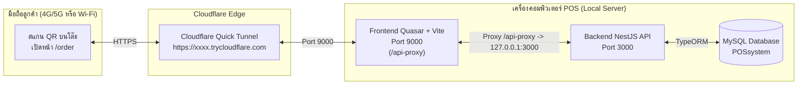

# สรุปรีวิวโค้ดและสถาปัตยกรรมระบบสแกน QR สั่งอาหารผ่านมือถือ (Mobile Self-Ordering & Cloud Tunnel)

เอกสารนี้สรุปการทำงานทั้งหมดตั้งแต่เริ่มพัฒนาฟีเจอร์ **สแกน QR Code สั่งอาหารที่โต๊ะผ่านมือถือ (`/order`)** การเชื่อมต่อ **Cloudflare Tunnel** เพื่อให้มือถือสแกนได้ทั้งเน็ตมือถือ (4G/5G) และ Wi-Fi ร้าน รวมถึงการซิงค์ข้อมูลเข้ากับ **Backend NestJS + MySQL** และหน้าจัดการออเดอร์ (**KDS `/orders/manage`** & **ประวัติออเดอร์ `/orders`**)

---

## 1. ภาพรวมสถาปัตยกรรม (System Architecture)



---

## 2. สรุปสิ่งที่พัฒนาและแก้ไขทั้งหมด

### 2.1 ระบบหน้าเว็บสแกนสั่งอาหารผ่านมือถือ (Mobile QR Self-Ordering `/order`)
- **Public Route ไม่ต้อง Login (`frontend/src/router/routes.ts`):**
  - เปิดเส้นทาง `/order?tableId=1&tableNumber=T-01` ให้ลูกค้าสแกนจากกล้องมือถือหรือแอป LINE แล้วเข้าสู่หน้าสั่งอาหารของโต๊ะนั้นได้ทันที
- **4 แท็บหลักในหน้ามือถือ (`frontend/src/pages/mobile-qr-order-page.vue`):**
  1. **เมนูอาหาร (`menu`):** ค้นหาเมนู กรองตามหมวดหมู่ แถบเมนูขายดี และกดรับโค้ดส่วนลดโปรโมชั่น (`WELCOME10`, `DISCOUNT50`)
  2. **ตะกร้ารอบนี้ (`cart`):** ตรวจสอบรายการอาหารที่เลือก ปรับลด/เพิ่มจำนวน ใส่หมายเหตุถึงครัว และกดยืนยันส่งเข้าครัว
  3. **สรุปรายการสั่ง & สถานะครัว (`status`):**
     - แสดงรายการอาหารที่สั่งไปแล้วทุกรอบของโต๊ะนั้น พร้อมแถบสถานะครัว 4 ขั้นตอนแบบเรียลไทม์ (`ส่งเข้าครัว` -> `กำลังปรุง` -> `พร้อมเสิร์ฟ` -> `เสิร์ฟแล้ว`)
     - แสดงสรุปค่าอาหาร ส่วนลดโปรโมชั่น VAT 7% ยอดสุทธิ และเครื่องคิดเลขหารเฉลี่ยต่อคน (Split Bill)
     - แจ้งให้ลูกค้า **ชำระเงินที่เคาน์เตอร์แคชเชียร์** เมื่อทานเสร็จ (ไม่มีการตัดบัตรหรือสแกนจ่ายเองในมือถือ เพื่อป้องกันปัญหาบิลค้าง)
  4. **ขออุปกรณ์เพิ่ม (`service`):** ปุ่มลัดสำหรับขอช้อนส้อม น้ำแข็ง จานแบ่ง ทิชชู่ ซอส หรือพิมพ์ข้อความแจ้งพนักงานโดยตรง
- **Bottom Sheet ปรับแต่งรสชาติรายเมนู (`frontend/src/components/mobile-order/mobile-item-sheet.vue`):**
  - เลือกระดับความหวาน (สำหรับเครื่องดื่ม) หรือระดับความเผ็ด (สำหรับอาหาร)
  - เลือกท็อปปิ้งเสริมพร้อมบวกราคาเพิ่มอัตโนมัติ (เช่น `+เพิ่มชีสเชดดาร์`, `+เพิ่มเบคอนกรอบ`, `+เพิ่มไข่มุกบราวน์ชูการ์`)
  - เลือกแท็กไม่ใส่ผัก/แยกน้ำแข็ง และพิมพ์หมายเหตุรายจาน

---

### 2.2 การเชื่อมต่อ Cloud เพื่อให้สแกนได้ทั้ง 4G/5G และ Wi-Fi
- **ปัญหาเดิม:** หาก QR Code ชี้ไปที่ `localhost:9000` หรือ LAN IP (`192.168.1.x:9000`) ลูกค้าที่ใช้เน็ตมือถือ 4G/5G จะเข้าไม่ได้ และเราเตอร์บางตัวมีระบบ AP Isolation บล็อกการคุยกันระหว่างมือถือกับคอมพิวเตอร์
- **วิธีแก้ด้วย Cloudflare Quick Tunnel + Vite Reverse Proxy:**
  1. **สคริปต์รัน Tunnel อัตโนมัติ (`frontend/scripts/start-tunnel.mjs`):**
     - รัน `npx cloudflared tunnel --url http://localhost:9000`
     - ดักจับลิงก์ `https://xxxx.trycloudflare.com` ที่ได้จาก Cloudflare แล้วบันทึกลงไฟล์ `frontend/public/tunnel-url.json` อัตโนมัติ
  2. **Vite Reverse Proxy (`frontend/quasar.config.ts` & `frontend/src/boot/axios.ts`):**
     - ตั้งค่า `axios` ให้ยิง API ไปที่ `/api-proxy` บนพอร์ต `9000`
     - ให้ Vite ส่งต่อ (Proxy) คำขอจาก `/api-proxy` ไปยัง Backend ที่ `http://127.0.0.1:3000`
     - ทำให้เปิด Tunnel แค่พอร์ต `9000` ตัวเดียวก็ใช้งานได้ทั้ง Frontend และ Backend โดยไม่ติด CORS หรือ Mixed Content
  3. **ดึงลิงก์ Cloud มาสร้าง QR Code อัตโนมัติ (`frontend/src/components/tables/table-qr-dialog.vue`):**
     - เมื่อพนักงานกดดู QR Code ของโต๊ะในหน้า `/tables` ระบบจะอ่าน URL ล่าสุดจาก `tunnel-url.json` มาสร้างเป็น QR Code ให้ทันที

---

### 2.3 ระบบฐานข้อมูล Auto-Seeder และการซิงค์ออเดอร์เข้าครัว
- **Auto-Seed ข้อมูลเริ่มต้น (`backend/src/database/seeds/database-seed.service.ts`):**
  - เมื่อรัน Backend ระบบจะตรวจสอบและสร้างข้อมูลเริ่มต้นลง MySQL ให้อัตโนมัติหากยังไม่มี:
    - `POS_BRANCHES` (สาขาหลัก สยาม ID `1`)
    - `POS_ROLES` (ตำแหน่งงาน IDs `1..4`: `admin`, `cashier`, `manager`, `kitchen`)
    - `POS_CATEGORIES` (หมวดหมู่สินค้า IDs `1..5`)
    - `POS_PRODUCTS` (เมนูอาหารและเครื่องดื่ม 15 รายการ IDs `1..15`)
    - `POS_PROMOTIONS` (โปรโมชั่นส่วนลด IDs `1..3`: `WELCOME10`, `DISCOUNT50`, `SUMMER20`)
    - `POS_CUSTOMERS` (ข้อมูลสมาชิกเริ่มต้น IDs `1..4`)
    - `POS_DINING_TABLES` & `POS_QR_CODES` (โต๊ะอาหาร `T-01` ถึง `T-16` พร้อมความจุที่นั่งจริง)
- **การบันทึกออเดอร์และป้องกัน Foreign Key Error (`backend/src/modules/orders/orders.service.ts`):**
  - บันทึก `OrderEntity` ก่อนเพื่อรับ `orderId` แล้วจึงบันทึก `OrderItemEntity`
  - ตรวจสอบความถูกต้องของ `promotionId`, `customerId`, `employeeId`, และ `tableId` ก่อนบันทึกทุกครั้ง

---

### 2.4 การปรับปรุง UX/UI หน้าจัดการออเดอร์ (`/orders/manage`) และประวัติออเดอร์ (`/orders`)
- **แก้ปัญหาตัวเลือกเสริม (Options/Toppings) ล้นกรอบการ์ด (`frontend/src/components/orders/order-ticket-item.vue`):**
  - แยกชื่อเมนูหลักออกจากตัวเลือกเสริม และแสดงตัวเลือกเสริมเป็น **Pill Badges (ป้ายแท็กแยกสี)** ที่ตัดขึ้นบรรทัดใหม่อัตโนมัติภายในกรอบการ์ด
- **แสดงรายละเอียดส่วนลดโปรโมชั่นและ VAT 7% บนการ์ดออเดอร์ (`frontend/src/components/orders/order-ticket.vue`):**
  - แสดงบรรทัด **ยอดรวมค่าอาหาร**, **ป้ายโปรโมชั่นที่ใช้ (ระบุ % หรือจำนวนเงินที่ลด)**, และ **ภาษีมูลค่าเพิ่ม (VAT 7%)** เหนือยอดรวมสุทธิ เพื่อให้ตรวจสอบที่มาของยอดเงินได้ชัดเจน
- **ลบข้อมูลจำลอง (Mockup) ออกทั้งหมด:**
  - ทั้งหน้ามือถือ (`/order`), หน้าจัดการออเดอร์ (`/orders/manage`), หน้าประวัติออเดอร์ (`/orders`), และหน้าโต๊ะอาหาร (`/tables`) เริ่มต้นแบบคลีนและแสดงเฉพาะออเดอร์จริงจากฐานข้อมูลเท่านั้น

---

## 3. ขั้นตอนและคำสั่งในการรันระบบ (เปิด 3 Terminals)

### Terminal 1: รัน Backend (NestJS พอร์ต 3000)
```powershell
cd d:\work\POSsystem\backend
pnpm run start:dev
```

### Terminal 2: รัน Frontend (Quasar Vite พอร์ต 9000)
```powershell
cd d:\work\POSsystem\frontend
pnpm run dev
```

### Terminal 3: รัน Cloudflare Tunnel (สำหรับสแกนผ่านมือถือ)
```powershell
cd d:\work\POSsystem\frontend
pnpm run tunnel
```
> **หมายเหตุ:** เมื่อ Terminal 3 แสดงข้อความ `[SUCCESS] คัดลอกลิงก์ด้านล่างนี้ไปวางในช่อง Server URL ของหน้า QR Code ได้เลย!` สามารถไปที่หน้า `/tables` บนคอมพิวเตอร์แล้วกดปุ่ม QR Code ของโต๊ะเพื่อสแกนจากมือถือได้ทันที
